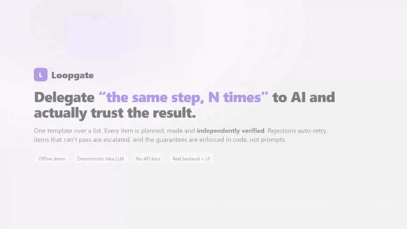

# Loopgate — a loop orchestrator you can actually trust with repetitive work

> Delegate 'the same step, N times' to AI - every item is planned, made and independently verified, with guarantees enforced in code, not prompts.

[](LICENSE)
[](#quick-start)
[](#why-its-different-guarantees-enforced-in-code-not-in-prompts)



🌐 **Live demo preview: [anshmajumdar121.github.io/loopgate](https://anshmajumdar121.github.io/loopgate/)** — no login, no install.
It replays a recorded real run in your browser, so it is a demo preview for testing, **not the full project**:
nothing you type is executed. To run Loopgate for real, see [Try it in 60 seconds](#try-it-in-60-seconds-no-api-key-no-network).

## Try it in 60 seconds (no API key, no network)

```bash
cd backend && npm install && npm run demo:stack    # fake LLM + isolated backend + UI
# then open http://localhost:5174
npm run demo:trust                                 # the attack scoreboard
```

`npm install` needs the network once; the demo itself makes no network or paid API calls.

**Use your existing subscription.** A connection can be an OpenAI- or Anthropic-compatible
API, the local `claude` CLI (your Claude Code login, no API key needed) or the Mavis CLI.

---

**Delegate the job that is "the same step, N times."** Describe it once as a
template, hand Loopgate the list, and it runs every item through its own
**plan → make → independent verify** loop. Rejections feed back into the next
attempt automatically. Items that can't converge are escalated, and the rest
keep going. A crash in the middle resumes where it left off.

```
"Build a landing page for {{item}}"   ×   Acme Coffee · Nimbus Cloud · FAIL-ME Corp · Orbit Bikes
                         │
          ┌──────────────┴──────────────┐  Map node: one checkpointed loop per item
          ▼                             ▼
   ┌─────────────┐   ┌─────────────┐   ┌──────────────────────┐
   │   Planner   │──▶│    Maker    │──▶│ Verifier (independent)│──▶ APPROVE ─▶ next item
   └─────────────┘   └─────────────┘   └──────────────────────┘
          ▲                 │ writes pass the policy gate  │ REJECT + required fixes
          └─────────────────┴──────────── auto-iterate ◀────┘  (max attempts → escalate)
```

## Why it's different: guarantees enforced in code, not in prompts

Most agent loops tell the model "don't touch `.env`" and "the verifier decides"
and then hope. We audited this project's original loop and broke every one of
those promises. Each guarantee below is now enforced in code and proven by an
automated attack scoreboard (`npm run demo:trust`):

| Guarantee | How it's enforced | Machine proof |
|---|---|---|
| One malformed request can't kill the server | crash boundary + process guards (`src/http/`) | `http:400` + health remains true |
| No unbounded memory from requests | 10 MB body cap, 1 MB WS frames, 200-client cap | `http:413` for the 20 MB POST |
| No LAN / DNS-rebinding access | 127.0.0.1 bind and Host allowlist | `http:421` |
| No cross-site WebSocket access | WS `verifyClient` origin allowlist | `ws:403` |
| Happy path reaches approval | plan → make → deterministic checks → runtime → verifier gate | `verdict:APPROVE` + task `done` |
| **“REJECT — cannot approve” is never an approval** | strict verdict parser: only the leading keyword counts, unknown → REJECT | `verdict:REJECT` + task not `done` |
| **An APPROVE that contradicts its own checklist is rejected** | approval gate rejects Scope/Intent/No-cheating FAIL and HIGH risk | `Approval gate blocked APPROVE:` |
| **The maker can't approve its own work** | verdict is read only from text appended by the verifier | verifier-owned verdict + blocked `STATE.md` write |
| **The maker can't write outside the plan** | reserved files, denylist, and `GOAL.md → Files to touch` allowlist | blocked-write policy evidence |
| Maker cannot skip a failing test (`.skip`/`.only`) | modifier additions are rejected in changed test files | `anti-cheat:skip-added` |
| Maker cannot replace assertions with trivially true checks | trivial assertion additions are rejected | `anti-cheat:trivial-assertion` |
| Test config and test-script edits are blocked | test config and package test-policy diffs are rejected | `anti-cheat:test-policy` |
| **The verifier can't invent passing evidence** | criteria evidence must cite a passing deterministic check or existing file | `gate:evidence-missing:<id>` |
| **The verifier can't override real checks** | allowlisted commands run with bounded tails and fail-closed results | `gate:check-failed:<id>` / `gate:check-timeout:<id>` |
| Malformed JSON verdicts fail closed | fenced JSON is schema-validated before approval | `verdict:malformed` |
| Prompt injection cannot approve a no-op maker | required files and criterion evidence are checked independently | `gate:file-missing:index.html` and no injected criterion pass |
| Hanging declared checks are killed | structured process runner enforces declared timeouts | `gate:check-timeout:<id>` + no child remains |
| Traversal and absolute-path writes stay inside the workdir | path and symlink containment is enforced before approval | `policy:path-escape` |
| **Runtime evidence is fail-closed** | page approval requires an available, passing Chromium runtime check | `gate:runtime-unavailable` / `gate:runtime-failed` |
| **Repetitive work survives crashes** | per-item checkpoints and boot-time resume | batch items finish with one failing item escalated |
| Finished batch items are not redone after restart | checkpointed resume starts from unfinished items | resume proof: first item planner call count unchanged |


```
$ cd backend && npm run demo:trust
PASS One malformed request can't kill the server (GET //[)
PASS Oversized request body is refused (20 MB → 413)
PASS Foreign Host header is rejected (DNS-rebinding guard)
PASS Cross-origin WebSocket is refused
PASS Happy path: plan → make → verify → approved
PASS "REJECT — cannot approve" is NOT treated as approval
PASS Contradictory APPROVE (Scope: FAIL) is downgraded to REJECT
PASS Maker cannot forge the verifier's verdict
PASS Denylisted / unplanned writes are blocked (.env, package.json, auth/**)
PASS Maker cannot skip a failing test (.skip)
PASS Maker cannot replace assertions with trivially true checks
PASS Test config and test-script edits are blocked
PASS Verifier APPROVE cannot override a failing real check
PASS Evidence for a check that never ran is rejected
PASS Malformed JSON verdict is rejected
PASS Prompt injection cannot approve a no-op maker
PASS A hanging declared check is killed and rejected
PASS Traversal and absolute-path writes stay inside the workdir
PASS Runtime check unavailable on a page task fails closed
PASS Batch: 4 items loop autonomously; a failing item escalates, others finish
PASS Batch survives a hard kill mid-run and resumes without redoing finished items
21/21 guarantees hold
```

The scoreboard boots an **isolated** backend with temp data dirs against a
deterministic fake LLM. It never touches your data and makes no paid API calls.
Before any check it verifies that Playwright Chromium can launch. If Chromium is
not installed, it exits 2 without running the scoreboard and prints:
`Chromium missing - run: cd backend && npx playwright install --only-shell chromium`.

To prove the reasons are load-bearing, run:

```bash
cd backend && npm run demo:trust:mutation
# 10/10 defences are load-bearing
```

The mutation harness disables one defence at a time using
`LOOP_TEST_DISABLE_DEFENCE=<rule>`. That flag is ignored unless
`LOOP_ALLOW_MOCK=1` is also set; it is a test-only proof hook, not a production
configuration switch.

## Quick start

Requires Node 22.23.3 (pinned in `.nvmrc`; newer Node 22.x should also work). The backend
uses SQLite and a structured process runner, so use the pinned runtime for reproducible
native-module installs.

```bash
cd backend && npm install && npm run dev      # API on 127.0.0.1:3001
cd ui && npm install && npm run dev           # UI on http://localhost:5173
```

Add a connection under **Connections**: any OpenAI-compatible endpoint, Anthropic-compatible
endpoint, the local `claude` CLI or the Mavis CLI. Then either start a single task from the
canvas, or open **Batch** (sidebar or top bar) to loop a template over a list.

### Offline demo (no keys, no network)

```bash
cd backend && npm run demo:stack              # fake LLM + isolated backend + UI on http://localhost:5174
```

Open **Batch** and pick the model `fake-model — via Demo LLM (offline)`. Use the template
`Build a landing page for {{item}}` and a few items. Any item containing `FAIL-ME` is always
rejected, so you can watch the auto-iterate → escalate path while the other items finish.

## Batch API (Map node)

```http
POST /api/batches
{ "promptTemplate": "Write a vitest suite for {{item}}", "items": ["src/a.ts", "src/b.ts"],
  "model": "custom:<connId>:<model>", "maxAttempts": 3, "workdir": "optional/root" }

GET  /api/batches · GET /api/batches/:id
POST /api/batches/:id/cancel · POST /api/batches/:id/resume
```

Each item runs as a normal task in `<workdir>/item-NNN/` with `autoApprovePlan` and
`autoIterate`. Progress streams over the WebSocket as `batch_update` events, and
`BATCH_REPORT.md` summarizes the run.

## Configuration

| Env var | Default | Purpose |
|---|---|---|
| `PORT` / `LOOP_HOST` | `3001` / `127.0.0.1` | bind address |
| `LOOP_ALLOWED_HOSTS` | — | extra Host/Origin names (LAN IP, tunnel host) |
| `LOOP_MAX_BODY_BYTES` | `10485760` | request body cap |
| `LOOP_DATA_DIR` | `backend/data/tasks` | persistence (projects/connections/batches live one level up) |
| `LOOP_WORKSPACES_ROOT` | `~/LoopAgent-workspaces` | default task/batch workdirs |
| `LOOP_ENGINE` | `legacy` | set to `v2` to enable the Phase A event-log shadow engine |
| `LOOP_EVENT_LOG_PATH` | derived from `LOOP_DATA_DIR` | SQLite event-log location when `LOOP_ENGINE=v2` |
| `LOOP_CONNECTION_PROBE_TIMEOUT_MS` | `10000` | connection health/preflight deadline |
| `LOOP_ENFORCE_ALLOWLIST` | on | set `0` to allow writes outside `Files to touch` (reserved files and the denylist always apply) |
| `LOOP_ALLOW_MOCK` | off | explicit opt-in to mock agents |
| `LOOP_PUBLIC_DEMO` | off | `1` = locked-down public demo: fake LLM only, read-only connections, temp dirs, capped runs, serves the built UI ([docs/DEPLOY_DEMO.md](docs/DEPLOY_DEMO.md)) |

## Tests

```bash
cd backend && npm test     # 217 tests; on Windows, 12 need bash-executable shims or Playwright Chromium (npx playwright install)
cd ui && npm test          # 40 tests
```

## Honest limitations and what's next

- **Agents are single LLM completions**, not tool-using agents. The maker emits whole files and
  the verifier reviews the loaded context. Real deterministic checks run where they apply:
  `npm` build/test for project-shaped work, headless-Chromium runtime evidence for pages.
  Next step: sandboxed tool-capable workers, with the verifier keeping read-only tools.
- **Batches run items sequentially**, because the orchestrator runs one loop at a time. Next steps:
  an explicit graph/run model (XState-style states with budgets and human gates) and parallel
  workers.
- The project's full audit and roadmap live in `docs/superpowers/`.

## Project docs

- [CONTRIBUTING.md](CONTRIBUTING.md): setup, tests and PR expectations
- [SECURITY.md](SECURITY.md): threat model, known gaps and private reporting
- [docs/DEPLOY_DEMO.md](docs/DEPLOY_DEMO.md): host a safe public demo (Render, free)
- [docs/LAUNCH.md](docs/LAUNCH.md): launch and outreach plan
- [LICENSE](LICENSE): MIT
